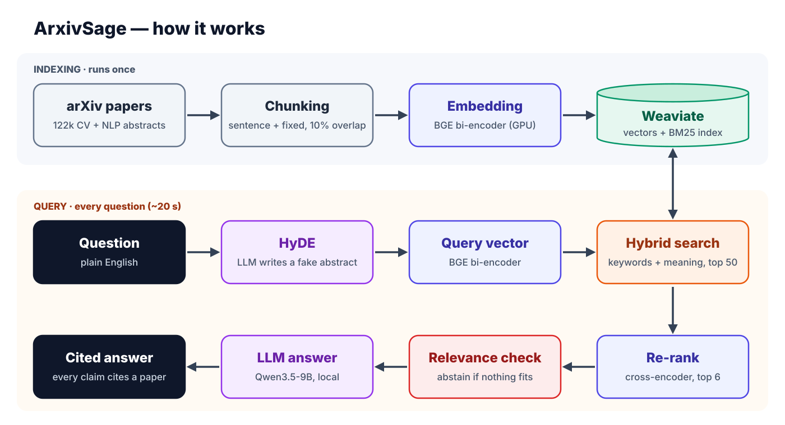
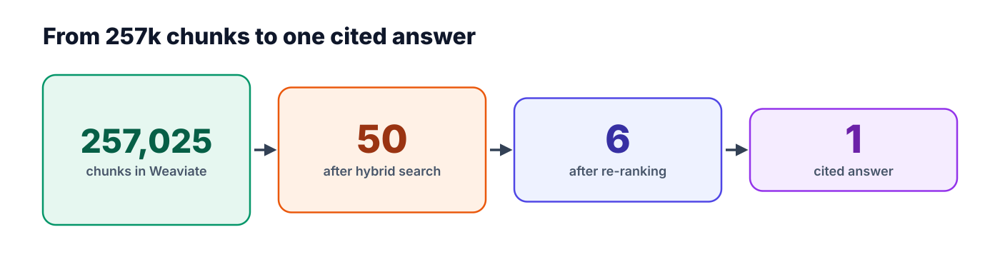
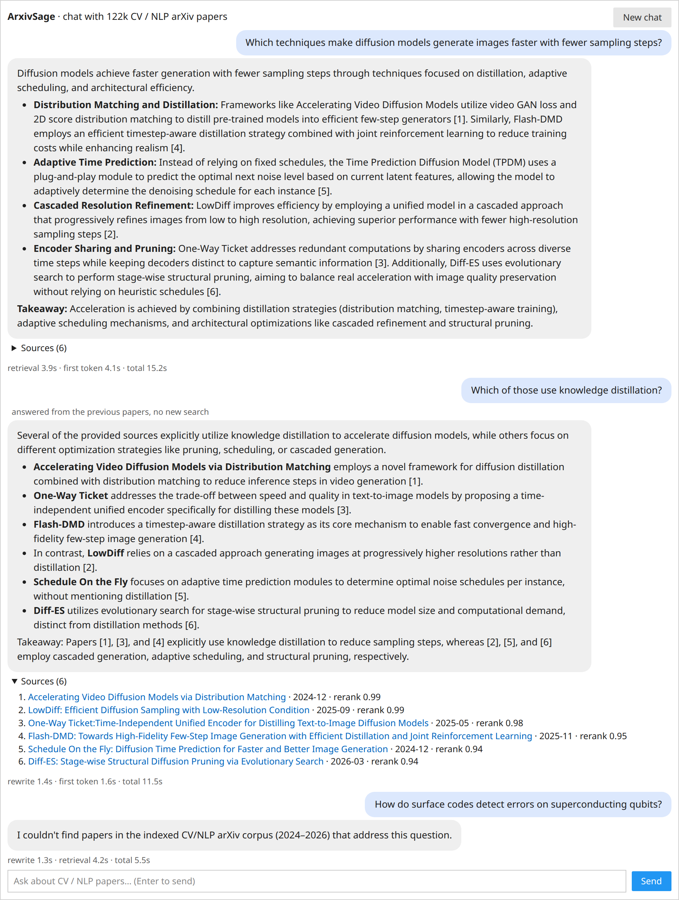

# ArxivSage

**Retrieval-augmented research assistant for Computer Vision and NLP papers, built on Weaviate.**

ArxivSage answers research questions over **122k arXiv papers** (cs.CV + cs.CL, last 2 years) with short,
synthesized answers in which every claim is **cited** to a retrieved paper. Questions outside the corpus
are declined instead of answered from model knowledge.

The system runs entirely **locally at no cost**: open data, open models, an embedded vector database and a single GPU.

---

## Architecture

<p align="center"></p>

<p align="center"></p>

**Query flow:**
1. **Routing** (chat only). An LLM reads the conversation and decides whether a follow-up can be answered from the previous papers, skipping steps 2–6, or needs a new search, in which case it is rewritten into a standalone question.
2. **HyDE.** An LLM writes a hypothetical abstract that would answer the question and extracts filters (years and categories in notebook 03; years only in notebook 04).
3. **Query vector.** The question and the hypothetical abstract are embedded with the same BGE bi-encoder and averaged.
4. **Hybrid search.** Weaviate runs BM25 on the question and HNSW vector search on the query vector, fuses the two lists (α = 0.6) and returns 50 chunks.
5. **Re-rank.** A cross-encoder scores each (question, chunk) pair and keeps the best chunk per paper: top 6 papers.
6. **Relevance check.** If the best score is below 0.05, the system abstains without calling the LLM.
7. **Answer.** Qwen3.5-9B answers only from the 6 numbered sources and cites each claim as [n] (streamed in notebook 04).

## Demo

<p align="center"></p>

Chat interface from notebook 04, showing a real session. The follow-up *"Which of those use knowledge distillation?"*
is answered from the same six papers with no new search, because the model decides it refers back to them. The
out-of-scope quantum question runs a new search, and the abstain gate declines it without calling the answer model.
The status lines report per-stage latency.

## Tech stack

| Stage | Choice | Why |
|---|---|---|
| Data | arXiv **OAI-PMH** bulk metadata | official, free, no API key, built for bulk harvesting |
| Chunking | **Mixed**: sentence units packed up to 120 words, fixed-window fallback, 10% overlap | coherent chunks *and* bounded size |
| Embeddings | `BAAI/bge-large-en-v1.5` (**bi-encoder**, 1024-d, fp16) | strong open retriever; documents embedded once, offline |
| Vector DB | **Weaviate 1.40 (embedded)**, one self-provided vector config | real Weaviate server with no Docker or account |
| Retrieval | **Hybrid** BM25 + HNSW, `relativeScoreFusion` (α = 0.6), year / category pre-filtering | exact jargon (LoRA, KV cache) *and* semantic paraphrase |
| Query parsing | **HyDE** + LLM-extracted filters in one JSON call: Qwen3.5-9B (notebook 03), **Qwen3.5-2B** with year filters only (notebook 04) | bridges short questions and long abstracts; the 2B matches the 9B's retrieval quality at 3.8 s vs 9.1 s |
| Re-ranking | `BAAI/bge-reranker-v2-m3` (**cross-encoder**), best chunk per paper | precise top 6 from a high-recall candidate set |
| Generation | `Qwen/Qwen3.5-9B` via **Hugging Face Transformers** (bf16), with an abstain gate | strong open model, runs in-process, follows citation rules |
| Orchestration | plain Python (notebook 03), **LangChain LCEL** (notebook 04) | explicit control vs. composable, streamable chains |
| Conversation memory | LLM routing of follow-ups (Qwen3.5-9B) + LangChain `SummarizationMiddleware` | follow-ups stay on the papers they refer to; bounded history |
| Interface | `ask()` (notebook 03), **ipywidgets chat UI** with token streaming (notebook 04) | first token after ~2–5 s |

## Dataset

| | |
|---|---|
| Source | arXiv OAI-PMH (`set=cs:cs:CV`, `cs:cs:CL`) |
| Window | papers first submitted in the last 2 years |
| Papers | **122,346** (74.3k cs.CV, 51.7k cs.CL, 3.6k in both) |
| Chunks | **257,025** (mostly 2 per abstract, 14–139 words) |
| Fields | title, abstract, authors, categories, submission month, URL |
| Disk | ~3.5 GB total (raw 0.2 GB, embeddings 1 GB, Weaviate 1.9 GB) |
| Download | prebuilt papers, chunks and embeddings: [`Sagnik2003/arxivsage-cv-nlp`](https://huggingface.co/datasets/Sagnik2003/arxivsage-cv-nlp) on the Hugging Face Hub (CC0) |

> **Scope:** the index covers **titles and abstracts**, not full text. It is strong at
> "which papers address X and how do their approaches compare?", and not at "what learning rate did paper Y use?".

## Quickstart

**Requirements:** Python 3.11, an NVIDIA GPU with **≥ 24 GB VRAM** (the LLM alone takes ~18 GB in bf16), ~25 GB of disk (5 GB data + 19 GB of model weights downloaded from Hugging Face on first run).

```bash
git clone https://github.com/Sagnik2003/ArxivSage.git && cd ArxivSage

conda create -n arxivsage python=3.11 -y && conda activate arxivsage
pip install -r requirements.txt
python -m ipykernel install --user --name arxivsage --display-name "Python (arxivsage)"

cp .env.example .env           # optional: choose the GPU (CUDA_VISIBLE_DEVICES)
jupyter lab
```

**Fast path (~5 min):** download the prebuilt data instead of harvesting and embedding it, then run
notebook 02, which reuses the embeddings and only builds the Weaviate index:

```bash
python download_data.py        # papers, chunks and embeddings (~1.5 GB) into data/
```

**Full build:** run the notebooks in order with the **Python (arxivsage)** kernel:

| Notebook | Stage | Time | Output |
|---|---|---|---|
| `01_collect_data.ipynb` | arXiv metadata harvest | ~8 min | `data/papers.jsonl` |
| `02_chunk_embed_index.ipynb` | chunking, embedding (GPU), Weaviate index | ~10 min | `data/chunk_embeddings.npy`, `weaviate_data/` |
| `03_rag_pipeline.ipynb` | RAG pipeline, examples, ablation | ~20 s / question | — |
| `04_langchain_version.ipynb` | LangChain implementation with streaming chat UI and memory | first token ~2–5 s | — |

Notebooks 01 and 02 run once. Notebook 03 exposes the pipeline as a function:

```python
ask("What new methods for KV cache compression were proposed since 2026?")
ask("Benchmarks for multimodal LLM reasoning", categories=["cs.CV"], year_from=2025)
```

Notebook 04 requires LangChain (not in `requirements.txt`):

```bash
pip install langchain==1.4.7 langchain-weaviate==0.0.8 langchain-text-splitters==1.1.3
pip install --no-deps langchain-huggingface==1.2.3   # keeps huggingface-hub 2.x for transformers
```

> Embedded Weaviate belongs to the Python process that starts it, so run **one notebook kernel at a
> time** against the index.

## Project structure

```text
ArxivSage/
├── common.py                    # configuration: paths, models, chunk sizes, ports, Weaviate client
├── download_data.py             # fetches the prebuilt data from the Hugging Face Hub
├── 01_collect_data.ipynb        # OAI-PMH harvest → filter → papers.jsonl
├── 02_chunk_embed_index.ipynb   # mixed chunking → bi-encoder → Weaviate
├── 03_rag_pipeline.ipynb        # HyDE → hybrid search → rerank → cited answer (+ ablation)
├── 04_langchain_version.ipynb   # LangChain implementation, streaming chat UI with memory
├── docs/                        # architecture diagrams, chat UI snapshot
├── requirements.txt
├── .env.example                 # machine-specific overrides (CUDA_VISIBLE_DEVICES)
├── data/                        # generated, git-ignored
└── weaviate_data/               # generated, git-ignored
```

Each notebook documents its stage; saved outputs are from a full run.

## Design decisions

**1. Hybrid search, not pure vector.** Bi-encoders blur exact identifiers: "LoRA", "KV cache", "DPO" and
model names are better matched by BM25, while paraphrases ("make diffusion faster" ↔ "few-step sampling")
need vectors. Weaviate fuses both inside the database. `relativeScoreFusion` min-max normalises each list,
so it keeps *how much* better one hit is, which rank-only RRF throws away.

**2. HyDE for the vector side, the raw question for BM25.** A 10-word question and a 200-word abstract sit
in different regions of embedding space. The LLM writes a hypothetical abstract that lands among real
abstracts. Its invented details don't matter because it's never shown to the user. The HyDE vector is
averaged with the real question vector so an off-topic generation can't hijack retrieval, and BM25 still
matches the exact words the user typed. The same JSON call also extracts time and category filters
("since 2026" → `year_from=2026`).

**3. Retrieve-then-rerank.** The bi-encoder compares two independently computed vectors, which is fast but
coarse. The cross-encoder reads query and chunk *together*, which is accurate but too slow for 257k chunks.
So: high-recall top 50, then precise top 6, keeping the best chunk per paper so citations are diverse.

**4. Mixed chunking.** Sentences are the variable-size units (abstracts have no paragraphs or sections). They are
packed greedily up to 120 words. Any sentence over the limit is cut into fixed windows. A 12-word (10%)
overlap keeps facts that straddle a boundary whole, and tiny trailing fragments are merged into the previous chunk.
Each chunk is embedded with its paper title prepended as a contextual header.

**5. Hallucination control in three layers:** a prompt that allows only the numbered sources and requires citations,
a cross-encoder score gate that refuses **before** calling the LLM, and source cards that let the reader check every claim.

**6. Submission dates from arXiv IDs.** In arXiv's OAI-PMH metadata, `<created>` is the date of the
**latest version**, not the first submission. Filtering on it admitted ~12k older papers that had only
been revised. The v1 submission month is taken from the arXiv ID instead (`2509.22630` → 2025-09).

**7. Follow-ups routed by the model (notebook 04).** A new search answers "which of *those*" badly, because it
replaces the papers the user is asking about. An LLM router reads the conversation and sends each follow-up either
to the previous papers, with no new search, or to the full pipeline. There are no keyword rules. On 22 test follow-ups
the 9B routed all correctly and the 2B 14, so routing runs on the 9B; since the 9B was selected on those same cases,
that score is likely optimistic. The answer step sees earlier questions but never earlier answers, so old citation
numbers cannot point at the wrong papers. Older turns are compressed by LangChain's `SummarizationMiddleware`, which
runs after the answer is displayed.

**8. Model split for latency (notebook 04).** HyDE output is never shown, so it runs on Qwen3.5-2B while
the 9B writes answers. Over 8 questions the 2B's hypothetical abstracts retrieved as well as the 9B's
(mean top-6 rerank score 0.946 vs 0.949) at 3.8 s instead of 9.1 s. The 2B's category predictions were
unreliable, so it extracts only year filters.

## Ablation

The same query under four configurations, top 5 results (from notebook 03).
Query: *"Which techniques make diffusion models generate images faster with fewer sampling steps?"*

| # | baseline (hybrid only) | + rerank | + HyDE | + HyDE + rerank |
|---|---|---|---|---|
| 1 | Glance: Accelerating Diffusion Models with 1 Sample | Accelerating Video Diffusion Models via Distribution Matching | Inference-Time Scaling for Diffusion Models beyond Scaling Denoising Steps | Accelerating Video Diffusion Models via Distribution Matching |
| 2 | Optimize Your Sampling: Tuned Diffusion Sampling with Bayesian Optimization | LowDiff: Efficient Diffusion Sampling with Low-Resolution Condition | Glance: Accelerating Diffusion Models with 1 Sample | LowDiff: Efficient Diffusion Sampling with Low-Resolution Condition |
| 3 | Inference-Time Scaling for Diffusion Models beyond Scaling Denoising Steps | Schedule On the Fly: Diffusion Time Prediction | UnStep: Training-Free Acceleration of Causal Video Diffusion | One-Way Ticket: Time-Independent Unified Encoder for Distilling T2I |
| 4 | UnStep: Training-Free Acceleration of Causal Video Diffusion | Pretrained Diffusion Models Are Inherently Skipped-Step Samplers | Unleashing High-Quality Image Generation in Diffusion Sampling | EMPURPLE: A Free Lunch for Diffusion Distillation |
| 5 | DiSA: Diffusion Step Annealing in Autoregressive Image Generation | Diff-ES: Stage-wise Structural Diffusion Pruning | Similarity Trajectories: Linking Sampling Process to Artifacts | Flash-DMD: Towards High-Fidelity Few-Step Image Generation |

Re-ranking moves off-target hits (inference-time *scaling*, artifact analysis) out of the top 5. HyDE + rerank
brings in the distillation-based few-step methods that the question is actually about. This is one
illustrative query, not a benchmark. A labelled evaluation set is on the roadmap.

## Configuration

All knobs live in [`common.py`](common.py):

| Setting | Default | Meaning |
|---|---|---|
| `CATEGORIES` | `["cs.CV", "cs.CL"]` | arXiv categories to index |
| `YEARS_BACK` | `2` | submission window |
| `CHUNK_WORDS` / `OVERLAP_WORDS` | `120` / `12` | chunk size limit and 10% overlap |
| `EMBED_MODEL` | `BAAI/bge-large-en-v1.5` | bi-encoder |
| `RERANK_MODEL` | `BAAI/bge-reranker-v2-m3` | cross-encoder |
| `LLM_MODEL` | `Qwen/Qwen3.5-9B` | any Hugging Face chat model (e.g. `Qwen/Qwen3.5-4B` for ~9 GB VRAM) |
| `FAST_LLM_MODEL` | `Qwen/Qwen3.5-2B` | notebook 04 only: small model for HyDE and chat summaries |

Retrieval knobs (`ALPHA`, `N_CANDIDATES`, `TOP_K_PAPERS`, `MIN_RERANK_SCORE`) are defined next to the code that uses them in notebook 03.

> **GPU:** all models run on one GPU, selected by `CUDA_VISIBLE_DEVICES` (default `0`, override in `.env`).
> Notebook 03 needs ~20 GB; notebook 04 loads both LLMs and needs ~25 GB. Models stay loaded until the kernel shuts down.

## Roadmap

- [ ] Full text for a subset of papers (arXiv HTML), with section-aware chunking and a `section` filter
- [ ] Labelled evaluation set (Recall@k, nDCG, citation faithfulness) to quantify each component
- [ ] Web front end (Gradio or Streamlit) for the chat interface, with persistent sessions
- [ ] Incremental daily updates through OAI-PMH `from=<last run>`

## Acknowledgements

Paper metadata courtesy of [arXiv](https://arxiv.org) via its OAI-PMH interface. Thank you to arXiv for use of its
open access interoperability. Models: [BGE](https://huggingface.co/BAAI) (BAAI), [Qwen](https://huggingface.co/Qwen) (Alibaba).
Vector database: [Weaviate](https://weaviate.io). HyDE: Gao et al., *Precise Zero-Shot Dense Retrieval without Relevance Labels* (2022).

## License

[MIT](LICENSE)
